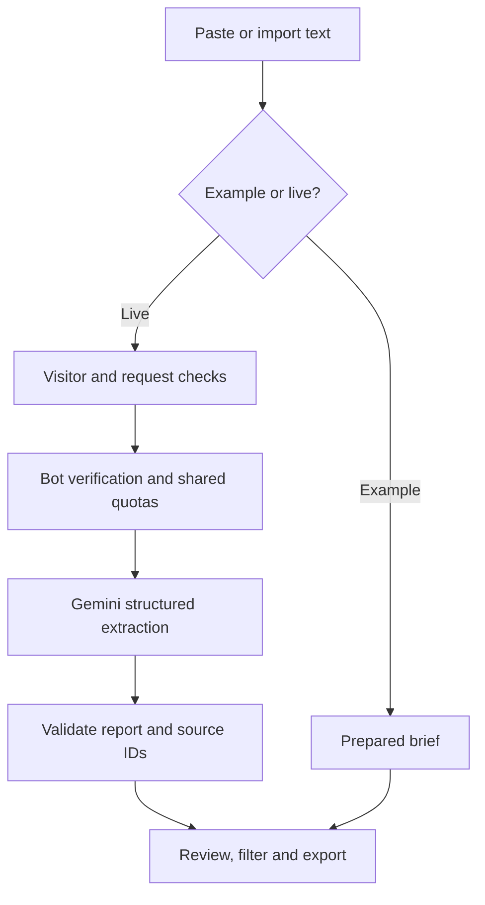

<p align="center">
  
</p>

<h1 align="center">Threadmark</h1>
<p align="center"><strong>Long chat. Clear next steps.</strong></p>
<p align="center">
  <a href="https://threadmark-sepia.vercel.app/">Try the demo</a> ·
  <a href="#a-small-example">See an example</a> ·
  <a href="#run-it-locally">Run locally</a> ·
  <a href="docs/DEPLOYMENT.md">Deploy on Vercel</a>
</p>

---

A price changes halfway through a chat. Someone suggests Friday instead of Monday. A task gets mentioned, but nobody agrees to take it on.

**Threadmark turns that conversation into a brief you can actually use:** decisions, next steps, important dates and questions that still need an answer. Every finding links back to the original lines so you can check what was said.

No account. No invitation. Paste a suitable conversation, complete the bot check, and create your brief. A prepared example works without credentials or an AI request.

## Why I built it

I've seen important details get buried in conversations about prices, deliveries and project work. Reading every message again takes time. A generic summary can be faster, but it can also make a suggestion sound like an agreement.

Threadmark focuses on that distinction. It helps people find the useful details while keeping the original words close enough to review.

## A small example

```text
Customer: We need 100 blue notebooks. Can you do RM10 each?
Seller: Yes, RM10 each for 100 blue notebooks.
Customer: Agreed. Can you ship on 25 October?
Seller: Confirmed, we will ship on 25 October.
Customer: Please send the invoice.
```

| Finding | What it means |
| --- | --- |
| RM10 per notebook | Confirmed in the chat. |
| Shipment on 25 October | The seller confirmed the date. |
| Send the invoice | Requested, but not explicitly accepted. |

The last row matters. Asking someone to do something doesn't prove they agreed to do it.

This example illustrates the intended behavior. AI can still misread a conversation, so findings always need human review.

## Inside the brief

- **At a glance:** the context in a few sentences.
- **Decisions:** agreements separated from proposals and replaced arrangements.
- **Next steps:** tasks with explicit **Who** and **When** fields. Missing information says “Not assigned” or “No date given.”
- **Needs an answer:** unanswered questions and unresolved details.
- **Source messages:** expand any finding to read the lines behind it.
- **Filters and export:** focus on one category or download the complete brief as Markdown, including its sources.

Status labels use everyday language: **Confirmed in chat**, **Suggested, not agreed**, **Needs confirmation**, **Replaced by a later agreement**, and **Reported done, not verified**. A reported completion isn't independent proof.

Paste text or import a `.txt` file. Live analysis accepts 20 to 20,000 characters. The workspace lives in browser memory and clears on refresh; Threadmark does not keep a report history.

## Public access, bounded usage

The Gemini key stays in server-only code. Browsers call `/api/analyze`, never Gemini directly. Removing sign-in does not remove the server checks.

| Control | Default |
| --- | --- |
| Analysis attempts per network | 2 per minute, 5 per UTC day |
| Analysis attempts across the whole site | 20 per UTC day |
| Simultaneous analyses | 1 per network, 3 across the site |
| Requests admitted before bot verification | 10 per network per minute, 120 site-wide |
| Conversation / request size | 20,000 characters / 256 KiB |
| Gemini execution | One call, no automatic retries, 90-second timeout, 4,096 output-token limit |

Redis reserves quotas atomically across Vercel instances. If Redis cannot confirm a reservation, Gemini is not called. Failed provider calls still count toward the allowance. Expiring leases recover slots after interrupted functions.

Visitors are grouped by their Vercel-provided IP address, with IPv6 grouped by /64, then keyed using a server-secret HMAC. The app does not store raw IP addresses in Redis. People on the same Wi-Fi share limits. VPNs and multiple networks can bypass individual limits, so the site-wide cap matters.

These controls bound admitted AI requests. They do not guarantee DDoS immunity, a fixed currency spend, or protection from provider-side credential theft. Use Vercel's firewall and provider quotas too. See [SECURITY.md](SECURITY.md).

## How it works



Gemini receives extraction rules in a separate system instruction, with conversation lines encoded as data. The Interactions API returns structured JSON with storage disabled. The server rejects unfinished responses, malformed reports and citations to nonexistent lines. These checks validate structure, not whether the model understood the conversation correctly.

## Built with

| Part | Technology |
| --- | --- |
| Interface | Next.js App Router, React, TypeScript, Tailwind CSS |
| AI extraction | Google GenAI SDK, Gemini Interactions API, Zod |
| Abuse controls | Cloudflare Turnstile, Upstash Redis with atomic Lua scripts |
| Hosting | Vercel |
| Checks | Node test runner, Playwright, Python with fakeredis/Lua |

Firebase and Google sign-in have been removed. No database of user accounts or conversations is needed.

## Run it locally

Use Node.js 24:

```bash
npm ci
npm run dev
```

Open `http://127.0.0.1:3000`. The example works without cloud credentials.

For live analysis, copy `.env.example` to `.env.local` and follow the [deployment guide](docs/DEPLOYMENT.md). Never commit `.env.local` or put the Gemini key in a `NEXT_PUBLIC_` variable. The repository includes placeholders only.

```bash
npm run test:security
python -m pip install -r tests/requirements.txt
python tests/quota_lua.py
npm run lint
npm run typecheck
npm run build
npx playwright install chromium
npm run test:e2e
npm run security:check
```

## Deploying the update

Already hosting an older version? Start with [the migration guide](docs/MIGRATION.md). It covers removing obsolete Firebase variables, adding `RATE_LIMIT_SECRET`, configuring anonymous quotas, and turning off Vercel's separate login wall.

Live analysis stays off until the required configuration is present. Preview deployments stay in example mode. Leave `ALLOWED_COUNTRIES` empty to remove the old Malaysia-only allowlist; Gemini unpaid-service restrictions still apply in the regions identified by the existing policy. Set `GEMINI_DATA_MODE=paid` only if that reflects your actual Google project.

## Scope and limitations

Threadmark is a portfolio project for reviewing conversation excerpts. It doesn't connect to WhatsApp, create legal agreements, save past reports or verify completed work. There is no published model-accuracy benchmark or penetration-test certification.

Use fictional or fully anonymised, non-confidential examples. Live analysis sends the text to Google Gemini; provider processing terms still apply even with interaction storage disabled.

See the [validation record](docs/VALIDATION.md), [maintenance notes](docs/MAINTENANCE.md) and [security notes](SECURITY.md) for implementation details and remaining deployment checks.

---

Built and maintained by **[Khaled Morshed](https://github.com/jeffyoh312)**.

Source code is licensed under the MIT License. Threadmark's name, logo and original branding are not licensed for reuse. Third-party assets retain their respective licences.
