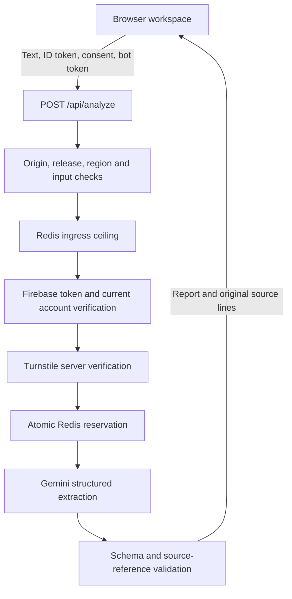

<p align="center">
  
</p>

# Threadmark

**Find the agreement. Keep the evidence.**

A price changes three times in a conversation. A shipping date is suggested, then confirmed. Someone asks for an invoice, but nobody accepts the task. A short summary can make all three sound settled.

Threadmark turns a conversation into a reviewable brief: what was discussed, what was agreed, what still needs doing, and which lines support each finding. It is a Next.js application with a Gemini extraction pipeline, Google sign-in, shared usage limits, and a credential-free example mode.

[Why it exists](#why-it-exists) · [The workflow](#the-workflow) · [Architecture](#architecture) · [Deploy](docs/DEPLOYMENT.md) · [Security](SECURITY.md) · [Validation](docs/VALIDATION.md)

## Why it exists

Small teams often negotiate and coordinate work in messages. The difficulty is not producing another paragraph about the conversation. It is recovering the current agreement without losing the revisions that led to it.

A useful brief needs to distinguish an offer from an acceptance, an assigned task from a request, and a reported completion from independent verification. It also needs a way to check those interpretations. Threadmark keeps source references attached to the findings rather than treating the generated prose as the final authority.

This is a portfolio demonstration of that workflow. It is not a contract engine, messaging integration or system of record. The public demo accepts fictional or fully anonymised business conversations only.

## An example of the distinction

```text
Customer: We need 100 blue notebooks.
Seller: The price is RM12 each.
Customer: Can you do RM10 each?
Seller: Yes, RM10 each for 100 blue notebooks.
Customer: Agreed. Can you ship on 25 October?
Seller: Confirmed, we will ship on 25 October.
Customer: Please send the invoice.
```

| Finding | Intended interpretation | Evidence |
| --- | --- | --- |
| RM10 per notebook | Confirmed revised price | Lines 3–5 |
| Shipment on 25 October | Confirmed shipping commitment | Lines 5–6 |
| Send the invoice | Requested action; no explicit acceptance | Line 7 |

These are illustrative expected interpretations, not a measured accuracy score. The model can still get them wrong. The interface keeps the evidence close enough to inspect.

## The workflow

1. Paste text or import a `.txt` file. File reading happens in the browser.
2. Explore the built-in example without an account, or sign in with Google for live analysis.
3. Confirm eligibility, content suitability and processing consent, then complete bot verification.
4. Submit an excerpt of 20 to 20,000 characters.
5. Review the brief, open supporting source lines and export the report as Markdown.

Findings are grouped into summaries, goals, decisions, actions, dates and open questions. Each finding carries a status: `proposed`, `confirmed`, `superseded`, `unresolved` or `reported_complete`. Owners and deadlines can be null when the conversation does not supply them.

The browser workspace is temporary. Refreshing clears the conversation, report and in-memory sign-in session. There is no saved-report history or automatic WhatsApp access.

## Architecture



The browser receives public Firebase configuration and a short-lived account token. Gemini, Redis and Turnstile server credentials stay in Vercel environment variables and server-only modules. Public source code does not need to contain a secret for the deployment to work.

### Evidence checks have a specific boundary

The server normalises line endings, assigns line numbers, then removes blank lines. A reference therefore still points to its original line number. After extraction, Zod validates the report structure and the server rejects references to nonexistent source lines.

That check proves that a cited line exists. It cannot prove that the line supports the finding. Semantic correctness remains a review task, and the interface does not label model output as verified fact.

### Spending limits live outside the browser

Disabling a button is useful interaction design, but it cannot enforce an API allowance. Redis executes the counter checks and reservation in one Lua operation, so concurrent Vercel instances share the same limits.

| Control | Default |
| --- | --- |
| Site ingress ceiling | 120 structurally valid requests per UTC minute |
| Per-user analysis attempts | 2 per UTC minute, 5 per UTC day |
| Site-wide analysis attempts | 20 per UTC day |
| Concurrent analysis | One active lease per user |
| Lease expiry | 120 seconds |
| Gemini timeout | 90 seconds |
| Automatic provider retries | Disabled |
| Maximum generated output | 2,048 tokens |

A reservation is consumed even if Gemini fails. Refunding failures would let repeated unsuccessful calls bypass the budget. Daily counters reset at midnight UTC, not 24 hours after each user's first request. Fixed windows can admit a burst across a minute boundary.

If Redis cannot confirm a reservation, analysis stops. A shared pause key blocks new admissions across deployments using the same namespace. This limits provider attempts through this app; it does not guarantee zero hosting costs, uninterrupted availability or protection against every form of abuse.

### Authentication is checked twice

The server verifies Firebase's JWT signature, issuer, audience, expiry, required claims, verified email and Google provider. It then asks Firebase for the current account state, rejecting deleted or disabled accounts and sessions older than the account's revocation timestamp. A valid signature alone is insufficient for immediate account revocation.

Google sign-in establishes identity, not good intent. Account quotas, a site-wide cap, Turnstile, an optional email allowlist and platform firewall controls address different parts of the abuse problem.

### A small application data footprint

Conversations and reports are not written to an application database. Firebase stores identity records; Upstash stores pseudonymous counters, locks and optional blocks. The browser holds the active workspace. Provider logs and provider content processing still exist, and the public privacy notice explains that distinction.

Gemini's unpaid service can use submitted content for product improvement and human review. `store: false` does not override those terms. The demo therefore prohibits personal, sensitive and confidential submissions, including private business conversations.

## Stack

| Layer | Technology | Role |
| --- | --- | --- |
| Application | Next.js App Router, React, TypeScript | Public pages, workspace and server route |
| Styling | Tailwind CSS | Responsive indigo/slate interface |
| Contract | Zod | Shared runtime and TypeScript report definitions |
| Extraction | Google GenAI SDK | Server-side Gemini request with structured output |
| Identity | Firebase Authentication, jose | Google sign-in and server token verification |
| Shared limits | Upstash Redis REST and Lua | Atomic quotas, leases and emergency pause |
| Bot verification | Cloudflare Turnstile | Single-use tokens verified on the server |
| Hosting | Vercel | Builds, server execution and trusted region headers |
| Verification | Node test runner, Playwright, Lua test harness | Request, identity, browser and quota checks |

## Deploy

The default build is an example-only site. No credentials are required to build it, and no live analysis is possible until the operator explicitly enables it.

For a Vercel deployment, import the repository, select the folder containing `package.json` as the root, use Node.js 24, install with `npm ci` and build with `npm run build`. Configure real values in Vercel, never in GitHub. A local `.env.local` is not required for a Vercel-only workflow.

[Deployment guide](docs/DEPLOYMENT.md) covers every environment variable, Firebase, Turnstile, Upstash, Google OAuth publication, domain verification, regional limits, platform protections and hosted acceptance checks. [Migration guide](docs/MIGRATION.md) covers replacing an older project without retaining nested source copies.

## Run the example as a contributor

```sh
npm ci
npm run dev
```

Open `http://127.0.0.1:3000`. No cloud credentials are needed for the example. Node.js 24 is the supported release environment. Optional local service variables belong in an ignored `.env.local`, with a development quota namespace.

## Verification

```sh
npm run test:security
npm run lint
npm run typecheck
npm run build
npx playwright install chromium
npm run test:e2e
npm audit --omit=dev
npm run security:check
```

Security tests exercise the ordered request pipeline with injected service adapters. They assert that denied requests cannot reach the model, that failed provider requests still release their lease, and that raw provider errors never become public responses. Identity tests use signed tokens, including wrong keys and claims. Browser tests cover the credential-free example and public pages. Quota tests execute the actual Lua scripts in an emulated Redis environment; they are distinct from a hosted Upstash acceptance test.

See [validation](docs/VALIDATION.md) for recorded results and untested boundaries. The GitHub workflow runs checks without deployment secrets. No model-accuracy benchmark, penetration-test certification or production uptime measurement is claimed.

## Repository map

| Path | Responsibility |
| --- | --- |
| `src/app/page.tsx` | Server entry point and public deployment settings |
| `src/components/workspace.tsx` | Input, report presentation, evidence navigation and export |
| `src/components/verification.tsx` | Turnstile widget lifecycle |
| `src/lib/use-auth.ts` | In-memory Google sign-in and account deletion |
| `src/app/api/analyze/route.ts` | Production dependency wiring |
| `src/lib/server/analyze.ts` | Ordered request checks and orchestration |
| `src/lib/server/gemini.ts` | Extraction prompt and bounded provider call |
| `src/lib/server/identity.ts`, `account-status.ts` | Token and current-account validation |
| `src/lib/server/quotas.ts`, `quota-scripts.ts` | Shared admission controls |
| `src/lib/server/release.ts` | Required configuration and regional policy |
| `src/lib/report-schema.ts` | Report contract and input limit |
| `src/app/privacy`, `terms`, `account`, `accessibility` | Public policy and account pages |
| `tests`, `scripts`, `.github/workflows` | Reproducible checks and release gates |
| `docs` | Deployment, maintenance, migration and validation |

## Current scope and next work

Implemented: pasted/text-file input, example report, grouped findings, source references, Markdown export, Google sign-in, account deletion, consent checks, bot verification, shared quotas, release gates and public policy pages.

Not implemented: messaging-platform integrations, persistent report history, team workspaces, report editing, human approval workflows or a representative accuracy benchmark. These would require additional data retention, access-control and evaluation design rather than simply adding buttons.

The next useful evaluation is a versioned set of fictional negotiations with expected decisions and evidence. Scoring unsupported conclusions separately from omissions would make extraction quality measurable without presenting schema validity as accuracy.

## Source and ownership

Maintained by Khaled Morshed. The repository is available for inspection. No open-source licence is granted by making the source public; third-party dependencies retain their own licences. The Threadmark name and supplied artwork are separate from dependency licences.
