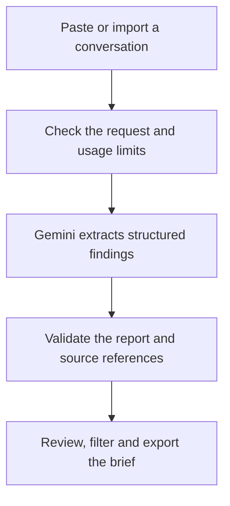

<p align="center">
  
</p>

<h1 align="center">Threadmark</h1>

<p align="center"><strong>Long chat. Clear next steps.</strong></p>

<p align="center">
  <a href="https://threadmark-sepia.vercel.app/">Try Threadmark</a> ·
  <a href="#a-small-example">See an example</a> ·
  <a href="#how-it-works">How it works</a> ·
  <a href="#run-it-locally">Run locally</a>
</p>

---

A price changes halfway through a chat. Someone suggests a different deadline. A task gets mentioned, but nobody agrees to take it on.

By the end, everyone has read the same conversation. That doesn't mean everyone remembers the same agreement.

**Threadmark turns messy conversations into clear, reviewable briefs.** It brings together decisions, next steps, important dates and unanswered questions, with links to the original lines behind each finding.

The idea is simple: make it easier to understand what happened, what needs doing and what still needs an answer.

## Why I built it

Important details often get buried in conversations about projects, prices and deliveries. Finding them again means scrolling through messages, following revisions and working out which suggestions actually became agreements.

An AI summary can save time, but it can also flatten those differences. “Could you send the invoice?” can become a task that sounds accepted. An earlier price can appear without the message that changed it.

I built Threadmark to make those distinctions easier to review. The brief keeps the useful details together, and the supporting messages stay close enough to check.

## A small example

```text
Customer: We need 100 blue notebooks. Can you do RM10 each?
Seller: Yes, RM10 each for 100 blue notebooks.
Customer: Agreed. Can you ship on 25 October?
Seller: Confirmed, we will ship on 25 October.
Customer: Please send the invoice.
```

A useful brief should recognise the difference between these findings:

| Finding | What the conversation supports |
| --- | --- |
| **RM10 per notebook** | The seller accepted the price and the customer agreed. |
| **Shipment on 25 October** | The seller confirmed the requested date. |
| **Send the invoice** | The customer made a request, but the seller has not explicitly accepted it. |

That last distinction matters. A request, an agreement and a completed task are three different things.

This example illustrates the intended behaviour. AI can still misinterpret a conversation, so each finding includes source references for the reader to review.

## Inside the brief

| Section | What it helps you understand |
| --- | --- |
| **At a glance** | What the conversation is about. |
| **Decisions** | What was agreed, proposed or replaced by a later agreement. |
| **Next steps** | What needs doing, who is responsible and when it is due. |
| **Needs an answer** | Questions and details that still need confirmation. |
| **Important dates** | Dates worth keeping track of, in the wording used in the conversation. |
| **Goals** | What the people involved are trying to achieve. |

Missing task details are visible: **Not assigned** for an unstated owner and **No date given** for an unstated deadline.

Findings also carry plain-language status labels, such as **Confirmed in chat**, **Suggested, not agreed** and **Needs confirmation**. When someone says work is finished, it is labelled **Reported done, not verified**.

You can filter the brief by category, expand the source messages below a finding, or export the complete brief as Markdown with its source references.

## Using Threadmark

1. **Bring a conversation.** Paste the text or import a `.txt` file. Use fictional or fully anonymised, non-confidential examples in the public demo.
2. **Create a brief.** Complete the submission confirmations and bot verification, then request analysis.
3. **Review what matters.** Read the decisions, tasks and unanswered questions. Open the supporting messages to check the details.
4. **Keep a copy.** Export the brief if you want to save it.

Want to see the result first? Choose **Explore an example** in the [demo](https://threadmark-sepia.vercel.app/). It opens a prepared brief without sending text to the AI service.

Live analysis accepts excerpts of **20 to 20,000 characters**. The workspace is temporary: refreshing or closing the page clears the conversation and report. Download an export before leaving if you want to keep it.

## How it works



The server assigns line numbers to the conversation and sends those lines to Gemini with instructions to distinguish agreements, proposals, requests and unresolved details. Every finding must cite supporting source lines.

Gemini returns structured JSON. The server checks the report's format and rejects references to lines that do not exist before the brief reaches the interface.

Those checks make the output easier to handle and review. They do not prove a finding is correct: the reader still needs to decide whether the cited messages support it.

### Protecting the public demo

Gemini requests run on the server, keeping the API key out of browser code. Cloudflare Turnstile checks submissions for automated abuse, while Upstash Redis coordinates usage limits across server instances.

Limits apply per network and across the whole site, with an additional cap on simultaneous analyses. People sharing a network may share an allowance. If usage checks are unavailable, the server stops the request before calling Gemini.

See [SECURITY.md](SECURITY.md) for the controls and their limitations.

## Built with

| Part | Technology |
| --- | --- |
| Application | Next.js, React and TypeScript |
| Styling | Tailwind CSS |
| Conversation analysis | Google Gemini through the Google GenAI SDK |
| Response validation | Zod |
| Shared usage limits | Upstash Redis and atomic Lua scripts |
| Bot verification | Cloudflare Turnstile |
| Hosting | Vercel |
| Automated checks | Node.js test runner, Playwright and Python with fakeredis |

## Run it locally

Use **Node.js 24**:

```bash
git clone https://github.com/jeffyoh312/threadmark.git
cd threadmark
npm ci
npm run dev
```

Open `http://127.0.0.1:3000`. The prepared example works without cloud credentials.

To enable live analysis, copy `.env.example` to `.env.local` and configure the services described in the [deployment guide](docs/DEPLOYMENT.md). Keep private credentials out of Git and browser-exposed environment variables.

For development checks and implementation details, see the [maintenance notes](docs/MAINTENANCE.md) and [validation record](docs/VALIDATION.md).

## Scope and limitations

Threadmark analyses the text you provide. It does not connect directly to WhatsApp or other messaging platforms, store a report history or independently verify that work was completed.

AI can miss context, misunderstand an agreement or cite a message that does not support its conclusion. Review the original words before relying on a finding. A brief does not establish a legal agreement.

Live analysis sends submitted text to Google Gemini. Use fictional or fully anonymised, non-confidential content and read the [Privacy Notice](https://threadmark-sepia.vercel.app/privacy) before submitting.

---

Built and maintained by **[Khaled Morshed](https://github.com/jeffyoh312)**.

Source code is licensed under the [MIT License](LICENSE). Threadmark's name, logo and original branding are not licensed for reuse. Third-party assets retain their respective licences.