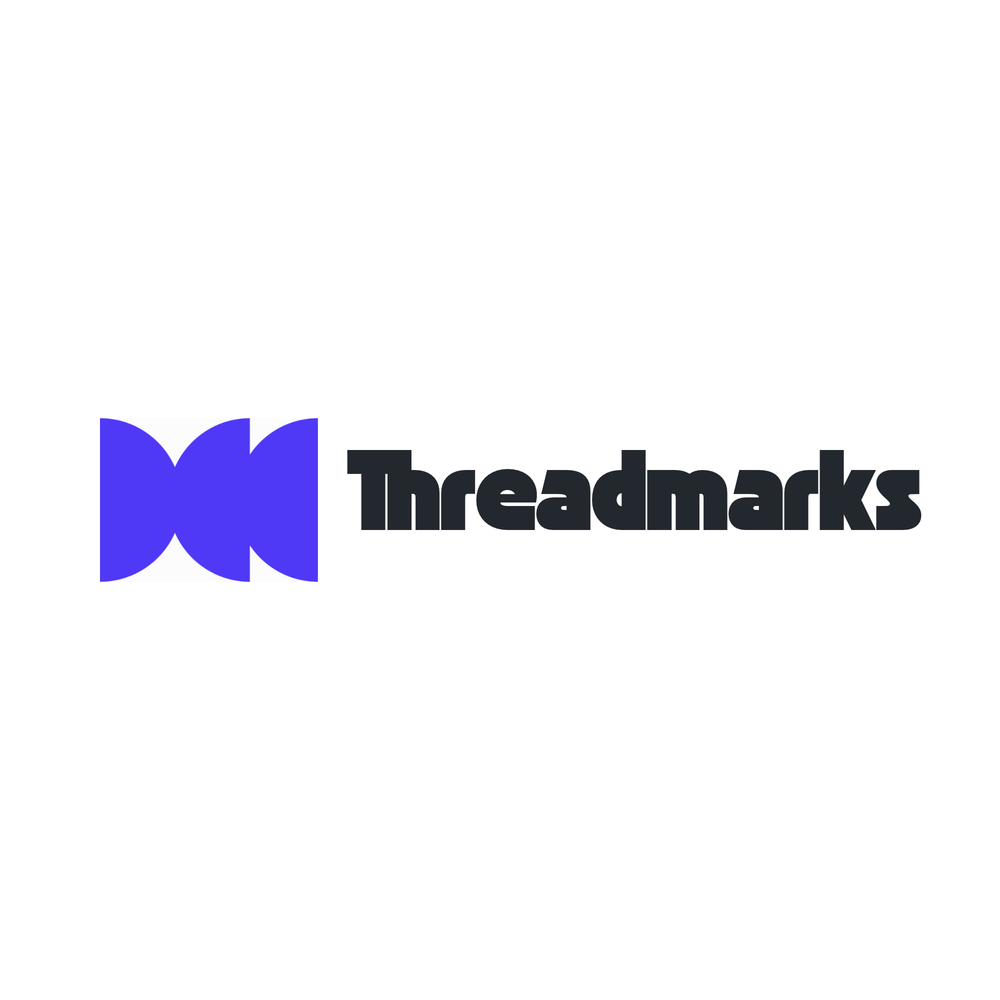

<p align="center">
  
</p>

<h1 align="center">Threadmark</h1>

<p align="center"><strong>Find the agreement. Keep the evidence.</strong></p>

<p align="center">
  <a href="https://threadmark-sepia.vercel.app/">Explore the demo</a> ·
  <a href="#how-it-works">How it works</a> ·
  <a href="#built-with">Built with</a> ·
  <a href="docs/DEPLOYMENT.md">Deployment guide</a>
</p>

---

A price changes halfway through a chat. Someone suggests a new deadline. A task gets mentioned, but nobody actually agrees to take it on.

By the end, everyone's been part of the conversation. That doesn't mean everyone remembers the same agreement.

**Threadmark turns messy conversations into clear, reviewable briefs.** It picks out decisions, next steps, important dates and unanswered questions, then shows the original lines behind each finding.

Because a summary is only useful if you can check where it came from.

## Why I built it

I've seen how easily important details get buried in long message threads, especially when people are discussing prices, deliveries or project work. Going back through the entire conversation takes time. Asking AI to summarise it is faster, but there's a catch.

A summary can make a suggestion sound final. It can turn "please send the invoice" into "the invoice will be sent", even though nobody accepted the request.

That distinction is the point of Threadmark.

The goal isn't to have AI decide what's true. It's to make the conversation easier to understand **while keeping the evidence close enough for a person to review**.

## A small example

Imagine this exchange:

```text
1  Customer: We need 100 blue notebooks.
2  Seller: The price is RM12 each.
3  Customer: Can you do RM10 each?
4  Seller: Yes, RM10 each for 100 blue notebooks.
5  Customer: Agreed. Can you ship on 25 October?
6  Seller: Confirmed, we will ship on 25 October.
7  Customer: Please send the invoice.
```

Here's what a useful brief should recognise:

| What it finds | What that actually means | Source |
| --- | --- | --- |
| **RM10 per notebook** | The revised price was accepted. | Lines 3–5 |
| **Shipment on 25 October** | The seller confirmed the date. | Lines 5–6 |
| **Send the invoice** | A request was made. No one explicitly accepted it. | Line 7 |

The last row matters just as much as the first two.

This is an illustrative example, not a claim that the model always gets these distinctions right. Threadmark links findings to source lines so you can judge them yourself.

## What you get

- **At a glance:** a short summary of what the conversation is about.
- **Decisions:** agreements made, including changes to earlier plans when the messages support them.
- **Next steps:** actions, owners and deadlines, when they are actually stated.
- **Dates and open questions:** things worth remembering and things that still need an answer.
- **Source evidence:** open the lines behind a finding instead of taking the AI's word for it.
- **Markdown export:** download a copy of the brief with its source references.

Threadmark also distinguishes between proposed, confirmed, replaced and unresolved details. If someone says a task is complete, that is treated as a *reported* completion, not independent proof.

## How it works

1. **Start with a conversation.** Paste the text or import a `.txt` file.
2. **Generate a brief.** For live AI analysis, sign in with Google, confirm the content is suitable and complete the verification step.
3. **Read what matters.** The report groups decisions, actions, dates and open questions into sections.
4. **Check the original words.** Each finding has a source link you can open. Export the brief if you want to keep it.

Curious before signing in? The [live demo](https://threadmark-sepia.vercel.app/) includes a **prebuilt example** that you can explore without an account or an AI request.

Live analysis accepts conversation excerpts of 20 to 20,000 characters when the service is enabled. The workspace is temporary: refreshing the page clears the conversation and report. There is no conversation history stored in a Threadmark account.

## Built with

I built Threadmark as a full-stack software project. The interface is only one part of it. There is also a server-side AI workflow, sign-in, checks on generated results and limits to protect the public demo.

**The app**


Next.js and React power the website and report interface. TypeScript keeps the application code predictable, while Tailwind CSS handles the responsive design.

**The analysis**


Gemini reads the conversation and produces the findings. Zod checks that the response has the right structure and that the cited source lines actually exist. It does **not** prove the model interpreted those lines correctly.

**The supporting services**


Firebase handles Google sign-in. Upstash Redis manages shared usage limits, and Cloudflare Turnstile helps filter automated requests. Vercel hosts the application and runs the server-side analysis route.

The project also uses **Playwright** and Node.js-based tests to check important user flows and request handling.

## A little more about the engineering

When you submit a conversation, Threadmark numbers the source lines and sends the text to a server-side analysis route. The server checks the request, verifies access and usage limits, then asks Gemini for a structured report.

Before the result reaches the screen, the app checks its format and source references. API credentials stay on the server, not in the browser.

One important boundary: **a valid source reference is not the same as a correct conclusion.** Threadmark is designed for review, not blind trust. There is no published model-accuracy benchmark yet.

For the deeper implementation details, see the [security notes](SECURITY.md), [validation record](docs/VALIDATION.md) and [deployment guide](docs/DEPLOYMENT.md).

## Try it locally

You can run the prebuilt example without cloud credentials:

```bash
npm ci
npm run dev
```

Then open `http://127.0.0.1:3000`.

Node.js 24 is used for the supported deployment setup. Live AI analysis requires separate service configuration; the [deployment guide](docs/DEPLOYMENT.md) covers it without putting secret keys in the repository.

## What it isn't (yet)

Threadmark is a portfolio project and an early demonstration of an evidence-backed conversation brief. It isn't a legal contract checker or a replacement for human confirmation.

It also doesn't connect directly to WhatsApp or other messaging platforms, save past reports, or provide shared team workspaces. You bring the text yourself.

**Please only use fictional or fully anonymised, non-confidential conversations in the public demo.** Live analysis sends submitted text to an external AI provider, whose processing terms still apply. Don't paste private client discussions, personal details or sensitive business information. See the app's privacy notice for more.

---

Built and maintained by **[Khaled Morshed](https://github.com/jeffyoh312)**.

The code is publicly viewable, but no open-source licence is granted by default. Third-party tools and artwork keep their respective licences.
